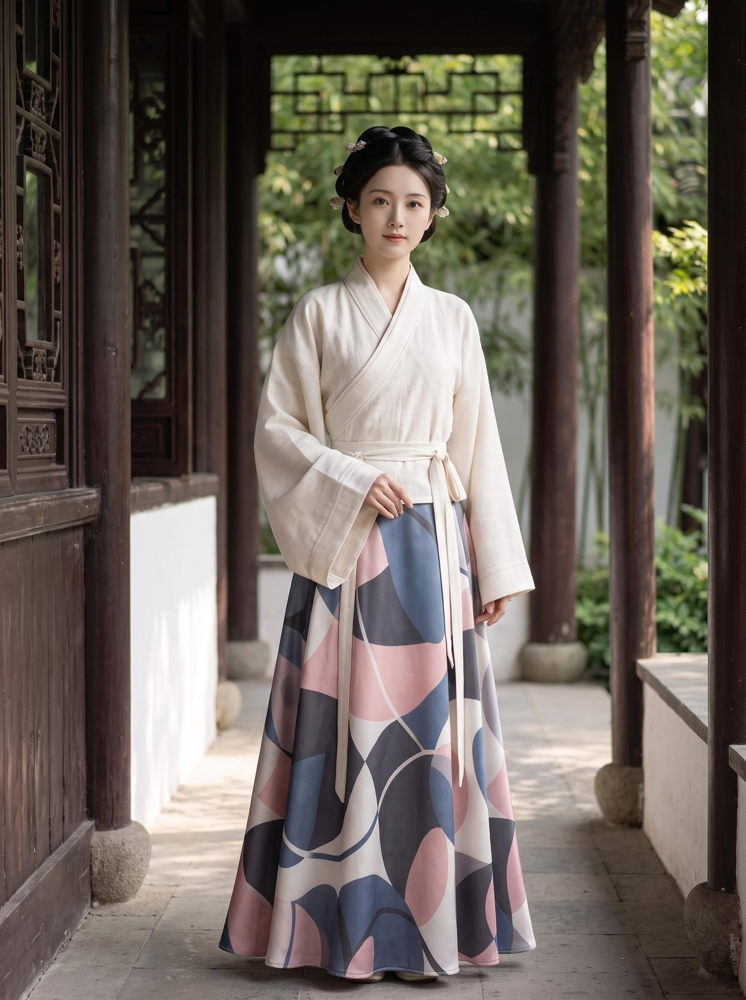

# 大唐诗路 · The Tang Verse <sup>v1.0</sup>

> 从一块数码印花缎面，走到七个场景、一部 82 秒的竖版短片 —— 唐风新中式系列套装设计
>
> From a bolt of digital-print satin to seven scene chapters and an 82-second vertical film — a Neo-Tang couture collection

[中文](#中文) | [English](#english)


<p align="center">
  <a href="https://podcatcher962.github.io/tang-verse/">
    
  </a>
</p>

---

## 中文

### 简介

**大唐诗路（The Tang Verse）** 是一次「材料到服装」的完整设计实验：先定面料（宝相花 / 卷草 / 联珠纹数码印花缎面），再出线稿、白底成品图与模特展示图，最后把同一套设计语言铺进七个场景——园林、T 台、都市、家居、水乡、古堡、未来。

全系列 **22 张设计图**，中英双语说明，附一部 **82 秒竖版发布片**（原创配乐）。整套页面与影片都可以直接用于作品集、发布会或内容平台。

| 项目 | 说明 |
|---|---|
| 🌐 在线浏览 | **https://podcatcher962.github.io/tang-verse/** |
| 🎬 发布片 | 1080 × 1920 · 25 fps · H.264 · 81.8 秒 · AAC 192k 立体声 |
| 🖼 图像 | 22 张 · 1792 × 2400 · JPG |
| 🈯 语言 | 中文 / English 一键切换 |
| 🌗 主题 | 宣纸浅色（绢本设色） / 绛纱深色（描金） |

### 发布片

页面内可直接播放（默认浅色版，可切深色版），也可下载：

| 版本 | 文件 | 大小 |
|---|---|---|
| ☀️ 浅色版 | [`the-tang-verse-showcase-light.mp4`](the-tang-verse-showcase-light.mp4) | 23.5 MB |
| 🌙 深色版 | [`the-tang-verse-showcase.mp4`](the-tang-verse-showcase.mp4) | 26.8 MB |

配乐为**程序合成的原创曲目**（古筝式拨弦 / 箫 / 太鼓 / 弦乐垫 / 钟锣），不含任何第三方采样，可放心商用；章节切换处全部卡在分镜转场上。

### 场景组（9 组 · 22 图）

| 组 | 名称 | 图数 | 设计语言 |
|---|---|---:|---|
| 01 | 🧵 材质系统 | 2 | 现代面料 × 唐风纹样 |
| 02 | 👘 首套 · 设计链路 | 3 | 线稿 → 白底成品 → 模特展示 |
| 03 | 🌿 园林意境 | 5 | 交领大袖、披帛、印花缎光泽 |
| 04 | 💡 舞台走秀 | 2 | 聚光、夸张廓形、朱砂泥金 |
| 05 | 🏙 都市白领 | 2 | 玄黑绀青、利落实穿 |
| 06 | 🍵 家居闲情雅致 | 2 | 月白青绿、宽松松弛 |
| 07 | ⛵ 诗意水乡 | 2 | 薄纱大袖、低饱和层叠 |
| 08 | 🏰 古堡怀旧 | 2 | 丝绒提花、织金长帔、烛光 |
| 09 | 🌌 超现实未来风 | 2 | 液态金属银缎、解构廓形 |

<p align="center">
  
  
  
</p>

### 设计链路

```
数码印花缎面样片（宝相花 / 卷草 / 联珠纹）
        ↓
   设计线稿（交领大袖 + 高腰下装）
        ↓
   白底成品图（印花缎 × 素色织纹拼接）
        ↓
   模特展示图（完整穿搭）
        ↓
七个场景组：园林 / 走秀 / 都市 / 家居 / 水乡 / 古堡 / 未来
        ↓
82 秒竖版发布片（三层动效 + 原创配乐）
```

### 题诗

> 云想衣裳花想容，春风拂槛露华浓。
> —— 李白《清平调 · 其一》

### 技术

- **页面**：单文件 `index.html`，纯 HTML + CSS + JS，无框架、无后台、无追踪、无 Cookie
- **背景**：宣纸 / 绢本纹理由程序生成（fbm 噪声），叠加唐锦宝相花平铺纹（206 px 循环），8 层 CSS 混合 + 内联 SVG 宝相花
- **影片**：Python + Pillow 逐帧渲染（三层：底图 / 装饰层横向漂移 / 卡片一次性上浮），ffmpeg xfade 合成
- **配乐**：纯 numpy 合成（拨弦加性谐波、箫的气噪与延迟颤音、FFT 卷积混响），按分镜时间轴对齐
- **图标 / 封面**：Pillow 生成，`唐` 字描金

### 声明

1. **AI 生成声明**：本项目的全部服装、模特与场景图像均由 AI 生成（美图设计室 / 内置图像生成模型），模特为虚拟形象，**并非真实人物**。依据《人工智能生成合成内容标识办法》，发布到公开平台时请勾选「AI 生成」标识。
2. 图像仅作设计概念与视觉呈现，不含真实商品；如需打样生产，请以实际面料与版型为准。
3. 页面与影片可自由浏览与分享；二次使用请注明作者与来源。

**作者**：© 永远的兰兰 · Lanlan Eternal ｜ **汇总页**：[兰斋丛编 · 兰兰软件集](https://podcatcher962.github.io/)

---

## English

### Overview

**The Tang Verse** is a complete material-to-couture experiment: it starts with the fabric (baoxianghua / scroll / pearl-motif digital-print satin), moves through a design sketch, a white-background sample and a model showcase, then carries the same design language into seven scene chapters — garden, runway, city, home, waterside, castle and future.

**22 images**, bilingual captions, plus an **82-second vertical film** with an original score. Everything here is ready to use as a portfolio, a launch page or social content.

| Item | Detail |
|---|---|
| 🌐 Live page | **https://podcatcher962.github.io/tang-verse/** |
| 🎬 Film | 1080 × 1920 · 25 fps · H.264 · 81.8 s · AAC 192k stereo |
| 🖼 Images | 22 · 1792 × 2400 · JPG |
| 🈯 Languages | 中文 / English toggle |
| 🌗 Themes | Rice-paper light (silk-painting palette) / madder-dark (gold-traced) |

### Film

Plays inline (light cut by default, dark cut available), and both are downloadable:

| Cut | File | Size |
|---|---|---|
| ☀️ Light | [`the-tang-verse-showcase-light.mp4`](the-tang-verse-showcase-light.mp4) | 23.5 MB |
| 🌙 Dark | [`the-tang-verse-showcase.mp4`](the-tang-verse-showcase.mp4) | 26.8 MB |

The score is **procedurally synthesised** (guzheng-like plucks, xiao, taiko, string pad, bell and gong) with zero third-party samples — safe for commercial use. Every chapter change lands on a cut point.

### Scene chapters (9 groups · 22 images)

| # | Chapter | Imgs | Design language |
|---|---|---:|---|
| 01 | 🧵 Material system | 2 | Modern fabrics × Tang motifs |
| 02 | 👘 Hero look · design chain | 3 | Sketch → sample → model |
| 03 | 🌿 Garden reverie | 5 | Cross-collar wide sleeves, shawl, satin sheen |
| 04 | 💡 Runway | 2 | Spotlight, dramatic silhouette, vermilion & ochre |
| 05 | 🏙 Urban professional | 2 | Ink and navy, sharp and wearable |
| 06 | 🍵 Home & leisure | 2 | Moon-white and celadon, loose and relaxed |
| 07 | ⛵ Poetic waterside | 2 | Sheer sleeves, muted layered drape |
| 08 | 🏰 Castle nostalgia | 2 | Velvet damask, gold-woven shawl, candlelight |
| 09 | 🌌 Surreal futurism | 2 | Liquid-metal satin, deconstruction |

### Notes

- **Page**: a single `index.html`, pure HTML/CSS/JS — no framework, no backend, no tracking, no cookies.
- **Backgrounds**: rice-paper and silk textures generated procedurally (fbm noise), overlaid with a 206 px Tang brocade tile, eight CSS blend layers and an inline SVG baoxianghua motif.
- **Film**: frame-by-frame with Python + Pillow (three layers: plate / drifting ornament / one-shot card rise), assembled with ffmpeg `xfade`.
- **Score**: pure numpy synthesis (additive plucks, xiao breath noise with delayed vibrato, FFT convolution reverb), aligned to the storyboard timeline.

### AI disclosure

All garments, models and scenes are **AI-generated** (Meitu DesignKit / built-in image model). The models are virtual, **not real persons**. Per China's labelling rules for AI-generated content, mark "AI-generated" when posting publicly. Images are concept visuals only — no physical product is implied.

**Author**: © Lanlan Eternal ｜ **All apps**: [Lanzhai · Lanlan's Software Collection](https://podcatcher962.github.io/)
